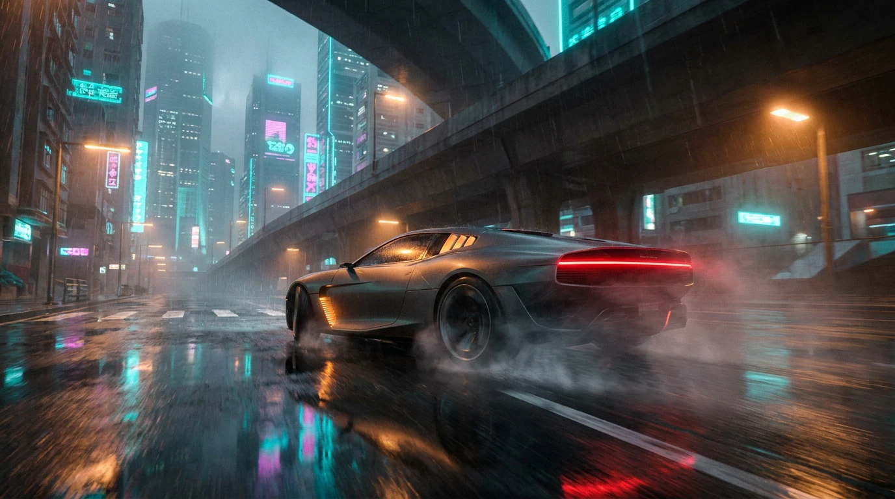
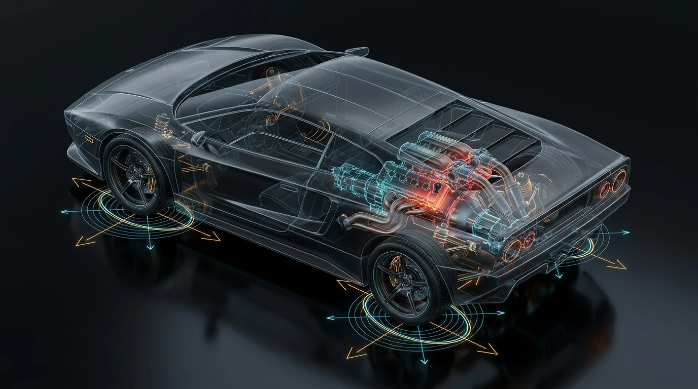
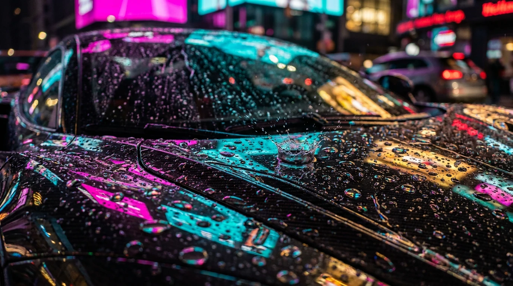
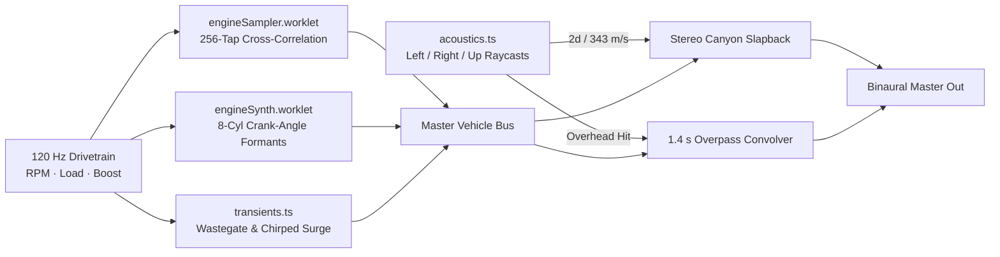
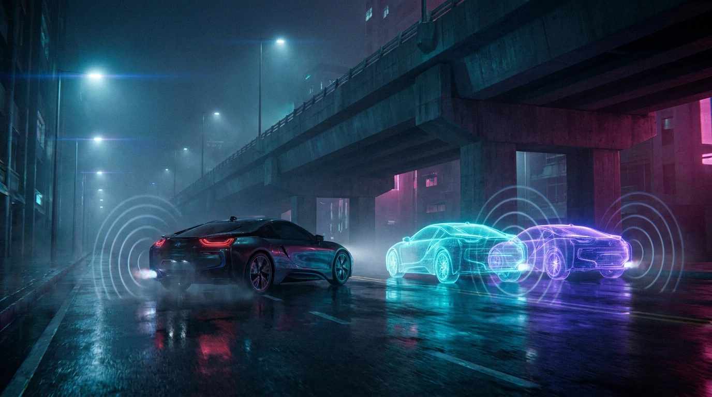

# Trapnest Neon: 120 Hz Midnight Physics in a Wet Megacity

It is 02:14 AM in the Lower Sprawl. Your headlights are slicing through $2,750$ GPU-simulated raindrops per frame, the $4.8\text{-liter}$ flat-plane twin-turbo V8 behind your shoulders is howling past $8,400\text{ rpm}$, **NEON·FM 88.7** is vibrating through the door panels, and a demolitions specialist named **FUSE** has just informed you over an encrypted comms channel that the volatile payload in your trunk is armed. If your speedometer drops below $90\text{ km/h}$ on the West Shore Freeway for more than five seconds, your chassis becomes part of the skyline.

Welcome to **[Trapnest Neon](https://neon.henrywithu.com/)**.

Where earlier chapters of the Trapnest project explored contemplative architecture (*Space*), tactile desk instruments (*Device*), and a six-kilometer procedural rainforest (*Maze*), **Neon** throws out the walking shoes entirely. It hands you the keys to eight bespoke machines, drops you into a rain-slicked cyberpunk metropolis at midnight, and asks a simple question: *how much real-time vehicle physics, acoustic synthesis, and WebGPU light transport can we pack into a browser tab before the tires lose grip?*

---

## 1. Anatomy of a Sleepless Megacity

A night-driving simulation lives or dies by the density of the world rushing past your side mirrors at $300\text{ km/h}$. You cannot fake speed in an empty void; you need rhythm—concrete bridge piers strobing past the A-pillar, sodium vapor giving way to magenta kanji, and multi-level highway interchanges stacking vertically overhead.

The Metro district in **Trapnest Neon** spans a continuous $1.6\text{ km} \times 1.6\text{ km}$ urban grid engineered for zero-stutter high-speed traversal:

| Urban Layer | Quantity | Engineering & Runtime Role |
| :--- | :--- | :--- |
| **Buildings & High-Rises** | $2,676$ structures ($765$ towers) | Packed into merged static batch buffers with procedural window-interior emissive atlases |
| **Neon Signage & Media** | $7,451$ neon signs + $27$ giant screens | Emissive MRT channel contributors that reflect in wet asphalt without being darkened by AO |
| **Elevated Highway Network** | $4$ expressways + $17$ bridges | *West Shore Freeway*, *Crosstown Expressway*, *Harbor Link*, and *East Bay Bridge* ($32,706$ tris, $156$ pillars, $90$ ramp colliders) |
| **Autonomous Traffic** | $28$ active vehicles | Directed lane-graph followers with forward occupancy checks and brake-light state machines |
| **Syndicate Content** | $17$ story jobs · $22$ races · $54$ sigils | Voiced mission chains, checkpoint sprints, and hidden rooftop lore collectibles |

### The $64\text{-Meter}$ Spatial-Hashed GPS

Threading a route across a city with four stacked highway decks and seventeen bridges requires more than a 2D minimap line. The navigation engine builds a directed half-edge road topology over every boulevard, ramp, and elevated deck, indexing nodes into $64\text{ m} \times 64\text{ m}$ spatial buckets via a deterministic prime hash:

$$
h(x, z) = \left\lfloor \frac{x}{64} \right\rfloor \cdot 73856093 \;\oplus\; \left\lfloor \frac{z}{64} \right\rfloor \cdot 19349663
$$

When you pin a syndicate drop-off or a street race start line, a binary-heap Dijkstra solver evaluates directed road edges in under a millisecond—applying an explicit angular reversal penalty so the glowing cyan GPS ribbon smoothly climbs highway on-ramps rather than telling you to pull a suicidal U-turn across a concrete median.

> **Field Note — Parked in the Rain:** If you ever want a breather from running syndicate contraband, pull over beneath a canal bridge, leave the engine idling, and press **`J`**. Built right into the dashboard is the **Trapnest Journal**—an in-world reader containing every long-form essay published on `henrywithu.com` since July 2026, paired with the 15-track **NEON·FM 88.7** night-drive radio rotation. (And if you only want to admire the bodywork under claustrophobic neon signage, append `?alley` to the URL to boot directly into a hidden back-alley diorama.)

---

## 2. Eight Machines, Zero Compromises

You start your first night with two keys on the rack: the heavy-shouldered **Quadra Turbo-R** and Hagane's $9,000\text{ rpm}$ flat-plane screamer, the **Tsurugi**. The remaining six machines cannot be bought; they have to be earned on wet asphalt by hunting down the city's **54 hidden sigils**, clearing **17 syndicate jobs**, and winning all **22 underground races**.

| Machine | Powertrain | Mass | Redline | Peak Torque | Top Speed | Drift Limit | Unlock Condition |
| :--- | :--- | :--- | :--- | :--- | :--- | :--- | :--- |
| **Quadra Turbo-R** | $4.2\text{ L}$ Twin-Turbo V8 | $1,480\text{ kg}$ | $7,500\text{ rpm}$ | $605\text{ N}\cdot\text{m}$ | $317\text{ km/h}$ | $44^\circ$ | **Starter** (Night One) |
| **Tsurugi** *(Hagane)* | $4.8\text{ L}$ Flat-Plane TT V8 | $1,330\text{ kg}$ | $9,000\text{ rpm}$ | $600\text{ N}\cdot\text{m}$ | $308\text{ km/h}$ | $46^\circ$ | **Starter** (Night One) |
| **Velora Turbo** | $2.8\text{ L}$ Turbo Flat-Six | $1,240\text{ kg}$ | $8,000\text{ rpm}$ | $535\text{ N}\cdot\text{m}$ | $276\text{ km/h}$ | $52^\circ$ | **18 Sigils** ($1/3$ found) |
| **Tachyon** *(Arclight)* | $6.0\text{ L}$ V12 · Hybrid Boost | $1,390\text{ kg}$ | $8,500\text{ rpm}$ | $650\text{ N}\cdot\text{m}$ | $339\text{ km/h}$ | $42^\circ$ | **3 Story Jobs** cleared |
| **Raijin** *(Kaiju Works)* | $3.0\text{ L}$ Twin-Turbo I6 | $1,420\text{ kg}$ | $8,000\text{ rpm}$ | $660\text{ N}\cdot\text{m}$ | $310\text{ km/h}$ | $50^\circ$ | **36 Sigils** ($2/3$ found) |
| **Katana GTR-88** | $3.0\text{ L}$ TT V6 · Hybrid | $1,280\text{ kg}$ | $8,500\text{ rpm}$ | $690\text{ N}\cdot\text{m}$ | $320\text{ km/h}$ | $48^\circ$ | **All 54 Sigils** found |
| **Vanta** *(Null Sector)* | $2.0\text{ L}$ Turbo Four · Dogbox | $1,150\text{ kg}$ | $8,500\text{ rpm}$ | $590\text{ N}\cdot\text{m}$ | $302\text{ km/h}$ | $38^\circ$ | **All 22 Races** won |
| **Chrysalis** *(Genesynth)* | Twin Bio-Turbine | $1,180\text{ kg}$ | $9,000\text{ rpm}$ | $705\text{ N}\cdot\text{m}$ | $359\text{ km/h}$ | $45^\circ$ | **100% Syndicate Completion** |

Every car in that table isn't a reskinned speed multiplier—it is a distinct mechanical personality governed by its own inertia tensor, piecewise torque lookup table, boost spool time constant, gear stack, aero downforce coefficients, and Pacejka tire compound.

- Take the **Velora Turbo**: at $1,240\text{ kg}$ with a short wheelbase and rear-biased mass, it sacrifices top-end expressway speed ($276\text{ km/h}$) for a $52^\circ$ maximum sustained drift angle that makes it an absolute scalpel in tight canal hairpins.
- Step into Null Sector's **Vanta**, and the physics flip completely: $70\text{ ms}$ sequential dog-box shifts, sticky $\mu = 1.45$ slicks, and aggressive underbody ground-effect tunnels ($k_{f} = 0.62$, $k_{r} = 0.96$) generate so much speed-squared downforce that the car practically suctions itself to the Crosstown Expressway.
- And if you conquer every last job, race, and rooftop sigil in the city, Genesynth's vat-grown **Chrysalis** awaits—delivering $705\text{ N}\cdot\text{m}$ from a twin bio-turbine that pushes terminal velocity to a terrifying $359\text{ km/h}$.

---

## 3. Rubber Meets Calculus: 120 Hz Pacejka Physics & Coupled Drivetrains

Most browser driving games rely on simplified arcade raycast springs with linear lateral friction. They work fine until you try to trail-brake into a wet 90-degree junction or hold a third-gear power slide—at which point the car feels like a bar of soap sliding across linoleum.

To make **Trapnest Neon** feel genuinely mechanical, the physics loop runs **Rapier 3D** at a fixed $120\text{ Hz}$ timestep ($\Delta t = 8.33\text{ ms}$), while the tire contact-patch solver sub-steps even faster internally.

### Self-Consistent Pacejka Magic Formula

Rather than hand-tuning fragile four-parameter empirical tables for every tire compound, our tire model (`tires.ts`) parameterizes each curve using two physically intuitive controls: **initial slip stiffness** $K$ and **post-peak grip falloff** $f \in [0.3, 0.99]$. From those two numbers, the shape factor $C$, stiffness factor $B$, and curvature factor $E$ are solved analytically so the peak of the curve is mathematically guaranteed to land at normalized slip $s = 1$:

$$
C = 2 - \frac{2}{\pi}\arcsin(f), \qquad B = \frac{K}{C}, \qquad E = \min\!\left(\frac{B - \tan\!\left(\frac{\pi}{2C}\right)}{B - \arctan(B)},\; 0.97\right)
$$

When a tire simultaneously accelerates (or brakes) with longitudinal slip ratio $\kappa$ and corners with lateral slip angle $\alpha$, both demands compete for the same finite patch of rubber. We normalize each axis by its peak slip threshold ($\kappa_{\text{peak}}, \alpha_{\text{peak}}$) to form a combined slip radius $s$ and evaluate the Pacejka response $Y(s)$:

$$
s = \sqrt{\left(\frac{\kappa}{\kappa_{\text{peak}}}\right)^2 + \left(\frac{\tan\alpha}{\tan\alpha_{\text{peak}}}\right)^2}, \qquad Y(s) = \sin\!\Bigl(C \arctan\bigl(Bs - E(Bs - \arctan(Bs))\bigr)\Bigr)
$$

Directional cosine weights $p = (\kappa / \kappa_{\text{peak}}) / s$ and $m = (\tan\alpha / \tan\alpha_{\text{peak}}) / s$ blend the longitudinal and lateral Magic Formula curves across the friction ellipse, while a non-linear **tire load sensitivity** term $a_{\text{load}}$ ensures that as weight transfers violently onto the outside tires during hard cornering, the friction coefficient per newton of vertical load $F_z$ decays just like real rubber:

$$
a_{\text{load}} = \operatorname{clamp}\!\left(1 - k_L \frac{F_z - F_{z0}}{F_{z0}},\; 0.65,\; 1.25\right), \qquad F_{\text{total}}(s, F_z) = \mu \, F_z \, a_{\text{load}} \Bigl(Y_{\text{long}}(s)p^2 + Y_{\text{lat}}(s)m^2\Bigr)
$$

That single equation is why stabbing the throttle mid-corner in the **Raijin** kicks the tail out so naturally: spiking longitudinal slip $\kappa$ inflates $s$ past $1.0$, dragging the lateral share $m \cdot F_{\text{total}}$ down the backside of the Pacejka peak.

### Sidewall Relaxation & The Implicit Jacobian Trick

Real tire carcasses are elastic; when you flick the steering wheel, the contact patch does not develop peak lateral force instantaneously. It has to roll through a physical **relaxation length** $L_{\text{relax}}$ ($0.14\text{ m}$ longitudinal, $0.28\text{ m}$ lateral) that shrinks dynamically as the tire approaches saturation:

$$
L_{\text{eff}}(s) = L_{\text{relax}} \cdot \operatorname{clamp}(1 - s^2,\; 0.06,\; 1.0), \qquad \kappa_{n+1} = \kappa_n + \bigl(\kappa_{\text{raw}} - \kappa_n\bigr)\!\left(1 - \exp\!\left(-\frac{|v_x|\,\Delta t_{\text{sub}}}{L_{\text{eff}}(s)}\right)\right)
$$

However, simulating stiff Pacejka tires on explicit Euler integrators introduces a classic nightmare of vehicle dynamics: **low-speed wheel-spin oscillation**. Near $v_x \to 0$, a tiny change in wheel angular velocity $\omega_w$ produces a massive swing in slip ratio $\kappa$, flipping tire force $F_x$ back and forth every tick.

Our solver eliminates this without artificial damping hacks by computing a numerical Jacobian $\partial F_x / \partial \kappa$ with a finite probe $\Delta\kappa = 0.004$ and folding the linearized tire stiffness directly into an **implicit effective wheel inertia** $I_{\text{eff}}$:

$$
k_\omega = \frac{\bigl|F_x(\kappa + \Delta\kappa) - F_x(\kappa)\bigr|}{\Delta\kappa} \cdot \frac{r_w}{\max(|v_x|,\; 1.2)}, \qquad I_{\text{eff}} = I_w + \Delta t_{\text{sub}} \, r_w \, k_\omega
$$

### 1.5-Way Clutch-Pack LSD & Coupled Crank-Axle Matrix

Upstream of the rear tires lives a full mechanical drivetrain (`drivetrain.ts`): an interpolated RPM torque curve, a first-order turbocharger boost pressure PDE with closed-throttle blow-off decay, a hysteresis rev-limiter fuel cut, a hyperbolic-tangent clutch slip law, and a **1.5-way clutch-pack Limited-Slip Differential (LSD)**.

Why "1.5-way"? Because under hard acceleration, you want the differential ramps to lock aggressively ($k_{\text{power}} = 0.42$) so both rear tires dig out of a drift together; on throttle lift-off, you want the ramps to relax ($k_{\text{coast}} = 0.22$) so the car rotates cleanly into the apex without understeering:

$$
\tau_{\text{lsd}} = \operatorname{clamp}\!\Bigl(k_d(\omega_L - \omega_R),\; -\bigl(T_0 + k_{\text{ramp}}|\tau_{\text{drive}}|\bigr),\; +\bigl(T_0 + k_{\text{ramp}}|\tau_{\text{drive}}|\bigr)\Bigr)
$$

When the clutch is locked and the engine spins above $35\text{ rad/s}$, the engine flywheel $I_e$ and both rear wheels ($I_{\text{eff},L}, I_{\text{eff},R}$) are no longer independent bodies—they form a coupled mechanical system through the total gear reduction $G = g_{\text{gear}} \cdot g_{\text{final}}$. Letting $J_e = \frac{1}{4} I_e G^2$ denote the reflected flywheel inertia at each half-shaft, the solver inverts the exact $2 \times 2$ coupled inertia matrix every substep:

$$
\begin{bmatrix} I_{\text{eff},L} + J_e & J_e \\ J_e & I_{\text{eff},R} + J_e \end{bmatrix} \begin{bmatrix} \dot{\omega}_L \\ \dot{\omega}_R \end{bmatrix} = \begin{bmatrix} \tau_{\text{road},L} - \tau_{\text{lsd}} + \frac{1}{2}G(\tau_e - \tau_{\text{drag}}) \\ \tau_{\text{road},R} + \tau_{\text{lsd}} + \frac{1}{2}G(\tau_e - \tau_{\text{drag}}) \end{bmatrix}
$$

### The Art of the Manji: PD Yaw Control

Great drift physics walk a razor's edge between raw Newtonian chaos and intuitive counter-steer authority. When you tap the handbrake or kick the rear tires loose above $10\text{ m/s}$, the chassis enters a dedicated drift state machine that tracks your sideslip angle $\beta$ against the road's natural centripetal yaw rate $a_\perp / v$ using a **Proportional-Derivative (PD) yaw-acceleration controller** ($K_p = 26$, $K_d = 8$):

$$
\alpha_{\text{yaw}} = \operatorname{clamp}\!\left(K_p\bigl(\theta_{\text{target}} - \beta\bigr) + K_d\!\left(\frac{a_\perp}{v} - \omega_y\right),\; -\alpha_{\max},\; \alpha_{\max}\right)
$$

When you’re sliding left at $42^\circ$ and suddenly snap the steering wheel right to link an S-bend (*a Manji transition*), the state machine detects the counter-steer polarity flip and opens a $220\text{ ms}$ low-damping whip window (`flipHold = 0.22`). The rear pendulum swings across centerline without bogging down, preserving your drift combo all the way to a $5\times$ telemetry multiplier.

---

## 4. Painting with Wet Photons: WebGPU Compute Rain & TSL Optics

Rain in a neon city isn't weather—it is half the lighting pipeline. Every puddle is a secondary mirror, every car panel is a distorting lens, and every overpass is an umbrella that needs to carve a dry shadow out of the storm.

### GPU Compute Rain & The `NearestFilter` Roof Trick

All $2,750$ active raindrops and surface crown splashes live permanently on the GPU inside `instancedArray` storage buffers, stepped every frame by a **WebGPU Compute Shader** written in Three.js Shading Language (`createCollisionRain.ts`).

To stop rain from falling through solid highway decks or tunnel roofs, a top-down $512 \times 512$ orthographic camera follows the player from $500\text{ m}$ overhead, rendering world-space roof heights into a single-channel `HalfFloatType` heightfield. In the compute shader, each falling raindrop compares its vertical coordinate $y$ against the heightfield $y_{\text{roof}}(x, z)$; upon impact, it terminates its streak and spawns an expanding crown-splash billboard $6\text{ cm}$ above the wet surface.

> **The Cleverest One-Line Bugfix in the Renderer:** When we first wired up the orthographic roof heightfield, raindrops kept exploding in mid-air twenty meters out from the walls of every skyscraper. Why? Because standard `LinearFilter` texture sampling was bilinearly interpolating between a $120\text{-meter}$ skyscraper rooftop and the $0\text{-meter}$ street below—inventing a phantom $60\text{-meter}$ diagonal glass ramp around every building in the city! Switching the height texture to `NearestFilter` (`magFilter = minFilter = NearestFilter`) snapped every building edge to a razor-sharp vertical cliff, and the mid-air phantom splashes vanished instantly.

### Sinuous Clearcoat Trails & Chromatic Lens Refraction

Look closely at the hood of your car while parked under a neon sign (`surfaceRain.ts`). Two multi-scale UV1 droplet grids ($1.0\times$ and $1.85\times$ density) stream backward across the clearcoat, driven by a combination of gravity and vehicle velocity. To mimic how real raindrops meander along waxed sheet metal due to surface tension, each trail's lateral path $w(y)$ follows a nested double-sine oscillation, while central-difference height taps ($\epsilon = 0.005$) perturb the clearcoat normal $\mathbf{n}_{\text{drop}}$:

$$
w(y) = \sin\!\bigl(10y + \sin(10y)\bigr), \qquad \mathbf{n}_{\text{drop}} = \operatorname{normalize}\!\left(\mathbf{n}_0 + s_n \frac{h(u+\epsilon, v) - h(u-\epsilon, v)}{2\epsilon}\mathbf{t} + s_n \frac{h(u, v+\epsilon) - h(u, v-\epsilon)}{2\epsilon}\mathbf{b}\right)
$$

On the camera glass (`rainGlass.ts`), each procedural droplet acts as a miniature dispersive prism. Instead of a single texture lookup, the shader offsets the screen-space refraction vector differently for Red, Green, and Blue channels (`0.85`, `1.00`, and `1.18` dispersion scales) and crowns each bead with a power-4 Fresnel rim.

### Emissive-Preserving GTAO & Six Cinema Grades

A classic pitfall of deferred and post-processed ambient occlusion is "muddy neon": if a glowing pink neon tube sits inside a recessed window frame, standard screen-space AO darkens the corner and turns your vibrant signage into soot.

**Trapnest Neon** avoids this by rendering into a 3-attachment Multiple Render Target (**MRT**) buffer—`output` (lit scene color $\mathbf{C}_{\text{raw}}$), `emissive` (pure self-illumination $\mathbf{E}$), and packed view-space `normal`. Half-resolution 16-sample Ground-Truth Ambient Occlusion (**GTAO**) is evaluated from the depth and normal buffers, and then composited **strictly onto reflected non-emissive light**:

$$
\mathbf{C}_{\text{lit}} = \max\!\bigl(\mathbf{0},\; \mathbf{C}_{\text{raw}} - \mathbf{E}\bigr) \cdot \text{AO} + \mathbf{E}
$$

Recessed concrete alleys get deep, velvety contact shadows, while the $7,451$ neon signs burn straight through the occlusion unblemished. From there, the frame passes through half-resolution bicubic planar ground reflections, a mip-chain bloom pyramid, radial nitro velocity blur, **FSR1 (EASU)** edge-adaptive spatial upscaling, and six live-switchable color grades:

1. **Neutral** — Clean midnight reference balance.
2. **Neon Noir** — Crushed cyan shadows with high-key specular highlights.
3. **Magenta Rain** — Split-toned sodium/violet street photography look.
4. **Teal Dusk** — Cold bioluminescent harbor grade.
5. **Silent Hill** — Bleached, oppressive low-saturation mist.
6. **Sin City** — Stark black-and-white monochrome with surgical isolated crimson for tail lights and warning beacons.

---

## 5. Mechanical Heavy Metal: Cross-Correlated Worklets & $343\text{ m/s}$ Acoustics

If you hold a flat-plane V8 at $8,800\text{ rpm}$ underneath a concrete expressway deck, it shouldn't sound like a pitch-shifted lawnmower. Our audio engine runs entirely inside dedicated **WebAudio `AudioWorkletProcessor`** threads paired with a real-time raycast acoustic model.

### Phase-Locked Granular Splicing via 256-Sample Cross-Correlation

Pitch-shifting a static engine loop across a $7,000\text{ rpm}$ range destroys the resonant formant frequencies of the exhaust manifold. Instead, `engineSampler.worklet.js` streams a real recorded acceleration pull using **two $50\%$-overlapping $70\text{ ms}$ Hann-windowed grains**.

As you accelerate, brake, or downshift, the worklet tracks the target timestamp in the recording that matches your live RPM. Whenever a grain's playhead drifts more than $60\text{ ms}$ away from that target, it leaps across the buffer by an integer multiple of the fundamental firing period. To ensure the jump never produces an audible click or hollow comb-filtering notch, the worklet executes a **256-sample normalized cross-correlation search (`align()`)** inside the real-time audio thread to splice the incoming grain at the exact phase angle of the outgoing waveform:

$$
S(d) = \frac{\sum_{k=0}^{255} x[\text{ref} + k]\, x[\text{target} + d + k]}{\sqrt{\sum_{k=0}^{255} x[\text{target} + d + k]^2}}, \qquad d^* = \arg\max_{d \in [-\frac{3}{4}T, +\frac{3}{4}T]} S(d)
$$

Beneath that phase-locked recording, we layer three physical synthesis stages:
- **Cross-Plane V8 Sub-Harmonic Cadence:** Below $170\text{ Hz}$, a crank-synchronous pulse train modulated by an 8-cylinder uneven bank amplitude table `[1.0, 0.78, 0.95, 0.72, 1.0, 0.84, 0.90, 0.76]` gives the idle its unmistakable burble.
- **Zero-Asset Crank-Angle Fallback (`engineSynth.worklet.js`):** Before sample buffers even finish decoding, a pure mathematical synthesizer advances crank phase $\theta \pmod 2$, firing all 8 cylinders with per-bank timing skew through alpha-function exhaust pressure pulses $E(t) = (t/\tau)\exp(1 - t/\tau)$ and three RPM-tracking formant biquads ($78, 240, 900\text{ Hz}$).
- **Chirped Compressor Surge & Overrun Crackles (`transients.ts`):** Snapping off the throttle above $3,200\text{ rpm}$ fires stochastic $1.5\text{ kHz}$ unburnt-fuel exhaust pops that pan left and right between dual tailpipes, while dumping high turbo boost triggers a three-part blow-off transient—complete with chirped compressor flutter pulses whose pitch sweeps exponentially from $2.9\text{ kHz}$ down to $1.1\text{ kHz}$ as the turbine stalls against the closed throttle plate.

### $343\text{ m/s}$ Raycast Canyon Slapback

An exhaust note in an open plaza sounds completely different from the same exhaust note bouncing between two brutalist high-rises. Every frame, `acoustics.ts` casts three physical probes from the chassis—left ($-x$), right ($+x$), and straight up ($+y$)—against the city's spatial building index and elevated highway decks.

The lateral wall distances $d_L$ and $d_R$ are converted directly into physical acoustic round-trip delay times using the speed of sound in air ($c = 343\text{ m/s}$):

$$
\tau_{L,R} = \operatorname{clamp}\!\left(\frac{2 \, d_{L,R}}{343\text{ m/s}},\; 0.018\text{ s},\; 0.180\text{ s}\right)
$$

Blast down a narrow $12\text{-meter}$ Chinatown alley and tight $35\text{ ms}$ stereo slapback reflections ping off the brick facades to your left and right. Dive underneath the double-deck *Harbor Link* expressway, and the vertical ray locks onto the concrete soffit overhead—opening the send to a $1.4\text{-second}$ stereo impulse-response convolver so your downshifts boom across the underpass.

---

## 6. Ghost Protocol & The Six Voices on the Wire

Even in a single-player midnight run, the city feels inhabited—first through the six syndicate operatives who hijack your comms frequency, and second through the translucent holographic ghosts of other real human drivers sharing your instance of the sprawl.

### The Syndicate Cast

| Callsign | Role | Signature Operations |
| :--- | :--- | :--- |
| **NYX** | *The Fixer* | High-priority syndicate courier contracts and encrypted drop-offs |
| **POPS** | *Dispatch* | Grid surveillance, onboarding, and route reconnaissance |
| **LUX** | *Drift Idol* | Style trials demanding sustained angle and linked Manji combos |
| **RIO** | *Speed Freak* | High-stakes midnight checkpoint sprints across the four expressways |
| **FUSE** | *Demolitions* | Volatile transport runs—including *Dead Man's Pedal* ($90\text{ km/h}$ minimum speed floor) |
| **HEX** | *Netrunner* | Guides your scanner toward **54 glowing sigils** hidden across rooftops and canals |

Each of the **54 sigils** scattered by **HEX** carries its own piece of world-building—from black-market neural wetware clinics in the Lower Sprawl to acoustic ghosts haunting the East Bay Bridge towers—rewarding curious drivers who use highway ramps as launchpads onto warehouse roofs.

### Hibernatable Edge Rooms & $3\text{ ms}$ Cooperative Ghost Baking

Open the multiplayer drawer and you can jack into five named edge rooms hosted on **Cloudflare Durable Objects**: **KEPLER**, **COPERNICUS**, **TURING**, **LOVELACE**, and **TESLA** (up to four concurrent drivers per shard).

To keep round-trip latency razor-thin without burning cloud storage budgets, the edge coordinator (`worker/index.ts`) uses **WebSocket Hibernation** (`WebSocketRequestResponsePair`) and stores player metadata directly inside in-memory socket attachments (`serializeAttachment()`). Pose packets—position, quaternion orientation, velocity, steering angle, and nitro state—stream through the edge with zero database writes.

On the client (`ghosts.ts`), remote drivers materialize as **non-colliding holographic ghost cars** rendered with a custom additive TSL shader featuring scrolling world-space scanlines, a traveling longitudinal radar wave, and a sharp Fresnel rim:

$$
I_{\text{holo}} = \bigl(1 - |\mathbf{N} \cdot \mathbf{V}|\bigr)^{2.4} \cdot \Bigl(0.82 + 0.28\sin(65 y - 9 t)\Bigr) + 0.45 \max\!\bigl(0,\; \sin(2.4 z - 5.5 t)\bigr)^6
$$

There is just one catch: cloning a high-poly sports car hierarchy and compiling custom TSL node materials on the fly takes around $18\text{ ms}$—more than enough to cause a visible hitch if someone joins **KEPLER** while you are grazing a bridge pillar at $290\text{ km/h}$.

To guarantee **zero frame drops**, ghost instantiation runs inside an asynchronous generator coroutine that checks `performance.now()` after every mesh child and yields back to the browser the moment its per-frame slice exceeds **$3.0\text{ ms}$**. Once materialized, each ghost smoothly extrapolates between network ticks using dead-reckoning velocity vectors and reconstructs front-wheel steering angles purely from chassis yaw rate $\dot{\psi}$ via Ackermann bicycle geometry:

$$
\delta_{\text{ghost}} = \operatorname{clamp}\!\left(\arctan\!\left(\frac{L \, \dot{\psi}}{v}\right),\; -0.55\text{ rad},\; +0.55\text{ rad}\right)
$$

---

## 7. Keys in the Ignition

Every piece of **Trapnest Neon**—from the implicit Jacobian stabilizing the rear tires at $0.5\text{ km/h}$, to the 256-sample cross-correlation loop splicing V8 exhaust grains in the audio thread, to the `NearestFilter` heightmap keeping rain off the lower deck of the West Shore Freeway—was built in service of a single feeling: that quiet, electric flow state of driving fast through a wet city at two in the morning.

The rain is falling, **NEON·FM 88.7** is live on the dial, and **KEPLER** has an open slot.

**[Launch Trapnest Neon → neon.henrywithu.com](https://neon.henrywithu.com/)**
