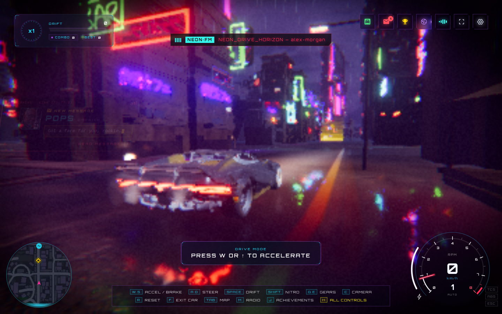
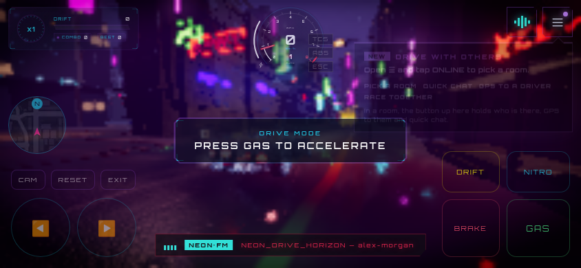
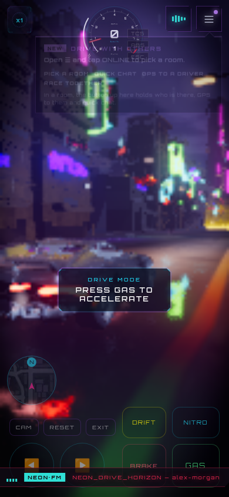
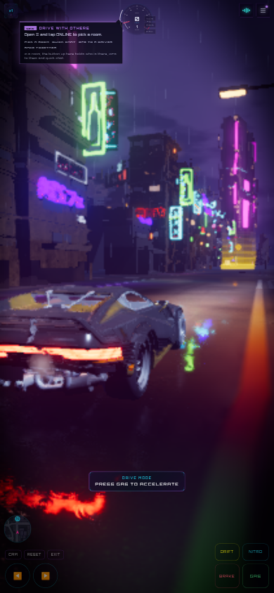

# Desktop and mobile playtest evidence

**Date:** 20 October 2026 (Asia/Taipei)

**Source baseline:** `768f657c6c245b129c8af6eebc780f7a8373979d`

**Production reference:** [neon.henrywithu.com](https://neon.henrywithu.com/)

## Findings first

Four concrete release concerns were reproduced: a failed required asset leaves no in-game recovery action; phone rotation scales the interface down severely; touch landscape About gives keyboard instructions and touch driving lacks a full Help entry; Settings lets keyboard focus escape its modal. Smaller text, phone instrument density, and undersized secondary touch targets also need polish. The [review](game-review.md) discusses their effect on the experience; the [plan](improvement-plan.md) maps them to work packages.

### F01 — Failed startup has no useful recovery

**Observed · P1 · Desktop/mobile runtime ownership**

1. In an isolated local browser context, block `/models/game/city/kit.glb`.
2. Load the production preview with the diagnostic WebGL backend.
3. Wait for initialization to fail.

The page displays “LINK FAILED.” The loader contains no button or link and retains `aria-busy="true"`. A browser reload is the only apparent recovery. This is an injected network failure, not a claim that the live site's asset was unavailable. Separately, source inspection found GPU-device loss logged to the console without a player-facing recovery surface; device loss was not injected in this pass.

Evidence: [failure capture](evidence/phone-load-failure.png), [failure observations](evidence/failure.json). Owners: [loader](../src/ui/loader/createLoaderOverlay.ts), [entry point](../src/main.ts), [renderer](../src/bootstrap/createRenderer.ts). Plan: R01.

### F10 — Rotation leaves a wide page scaled into a narrow phone

**Observed twice in Chromium touch emulation · P1 · Responsive/render sizing ownership**

1. Start at 844×390 with touch enabled, enter the game, then resize to 390×844.
2. Observe the much smaller HUD and touch targets.
3. Independently start fresh at 390×844, enter, rotate to 844×390, then return to 390×844.

The second sequence reproduces the same failure. Fresh portrait has a 390-pixel layout and scale 1. After returning from landscape, the document's client width is 390, but `innerWidth` and visual-viewport width remain 844 and visual scale becomes approximately 0.462. The old wide content is fitted into the narrow screen. This affects both driving controls and Settings. The viewport meta tag is present; its absence is not the explanation.

| State | `innerWidth` | Document client width | Visual-viewport width | Visual scale |
| --- | ---: | ---: | ---: | ---: |
| Fresh portrait | 390 | 390 | 390 | 1 |
| Landscape | 844 | 844 | 844 | 1 |
| Return to portrait | 844 | 390 | 844 | 0.4621 |

Evidence: [fresh portrait](evidence/rotation/portrait-drive.png), [return to portrait](evidence/rotation/back-to-portrait.png), [rotation observations](evidence/rotation/observations.json), [scaled Settings](evidence/phone-portrait-settings.png). Likely owners: [renderer sizing](../src/bootstrap/createRenderer.ts), [resize orchestration](../src/app/bootstrap.ts), root/canvas CSS. The exact sizing feedback needs investigation. Physical Android and Safari reproduction is still required. Plan: R02.

### F02 — Touch guidance and discoverability lag behind desktop

**Observed + source-backed · P1 · UI/input classification ownership**

1. Start the touch context at 844×390 and enter driving.
2. Open Menu: it offers Garage, Achievements, Online, Fullscreen, and Settings; there is no Help or dedicated Pause entry.
3. Open Settings → About and read the recommended setup near the end of the About copy.

About displays “Chrome or Edge with WebGPU · WASD to drive · Space to drift…” for this touch phone. The comprehensive driving help has computed `display: none` during touch driving. The ordinary About guidance becomes touch-specific at the narrower portrait breakpoint, demonstrating the width/input mismatch. Existing map, Settings, and radio paths can pause; the issue is discoverability and missing comprehensive touch help, not the complete absence of any pause mechanism.

Evidence: `phone.menu_text`, `phone.about_visible_instructions`, and `phone.drive_geometry` in [observations](evidence/observations.json); [touch menu](evidence/phone-menu.png). Sources: [About's width-only layout selection](../src/ui/chrome/createAboutPanel.ts), [header menu](../src/ui/chrome/createHeader.ts), [touch help suppression](../src/styles/reference/86-drive.css). Plan: R03.

### F03 — Settings does not contain keyboard focus

**Observed · P1 · Shared modal behavior ownership**

1. Enter the desktop game and open Settings.
2. Focus its final Reset game button without activating it, then press Tab.
3. Inspect the active element.

Focus moves to the document body, outside `.settings-glass`, instead of wrapping inside the modal. Settings declares `aria-modal="true"`. It does not implement the focus containment and restoration behavior already present in About. Other panels require their own audit; this check does not establish that every modal has the same defect.

Evidence: `desktop.settings_tab_escape.inside: false` in [observations](evidence/observations.json), [Settings capture](evidence/desktop-settings.png). Source: [Settings panel](../src/ui/chrome/createSettingsPanel.ts). Plan: R03.

### F04–F06 — First-session hierarchy and phone legibility

**Observed composition/measurements + design judgment · P2 · Game/UI/controls ownership**

- The opening presents five goal categories, including 17 jobs, 23 races, 54 sigils, and eight rides, before the first drive. This is a lot of long-term context before a concrete next action.
- The initial driving state can show a tutorial prompt, a radio ticker, a drift panel, a new-message/online cue, minimap, instruments, and desktop shortcut strip. Several are transient; the criticism concerns concurrent attention at entry, not a claim that they all remain permanently visible.
- At 844×390, CAM/RESET/EXIT are **29 CSS pixels high**. Main pedals and steering pads are substantially larger; the small-target finding is specific to the utilities.
- The phone dial is **112 CSS pixels wide**. Its authored 11-unit RPM numerals in a 280-unit viewBox render at roughly **4.4 CSS pixels** before viewport scaling. The main speed value is larger and useful.
- Fresh portrait also shows the radio ticker across part of the lower control region. Tooltip/message layers can remain visible behind reading surfaces. These states should be included in the HUD and overlay audit.
- Steering pads request discrete directions; the input layer smooths steering with speed. This establishes the control model, not a subjective conclusion that it handles badly. An analog option needs a physical-device comparison.

Evidence: [desktop driving](evidence/desktop-drive.png), [phone driving](evidence/phone-drive.png), [fresh portrait](evidence/rotation/portrait-drive.png), [controls overlay](evidence/desktop-help.png), geometry in [observations](evidence/observations.json). Sources: [speedometer](../src/ui/drive/speedometer.ts), [touch controls](../src/ui/drive/touchControls.ts), [input smoothing](../src/controls/createDriveInput.ts). Plan: R05–R07.

### F07–F09 — Measurements and creative opportunities

**Source-backed risks / editorial recommendations, not reproduced failures**

Mobile profiles already lower expensive effects and draw distance, but disable adaptive DPR. Whether this is the right stability/thermal tradeoff needs hardware evidence. Graphics-device loss currently has no visible recovery path. Distinctive routes, district audio, contact continuity, and stronger reward acknowledgment are proposed creative work; they are not claims that existing missions are broken or that no such feedback exists.

Sources: [performance profiles](../src/platform/performanceProfile.ts), [adaptive DPR](../src/platform/adaptiveDpr.ts), [mission/story definitions](../src/game/story/definitions.ts), [progress store](../src/game/progress/store.ts). Plan: R04, R08, R09.

## What was exercised

| Check | Desktop 1440×900 | Touch landscape 844×390 / portrait 390×844 |
| --- | --- | --- |
| Title → Nyx story → driving | Completed | Completed in landscape and independent fresh portrait starts |
| Real input events | Keyboard W and S, menu clicks and shortcuts | CDP touchStart/touchEnd on GAS, menu taps |
| Vehicle response | 180 explicit 1/60-second drive ticks reached 91.36 km/h and moved about 38.11 m | 60 ticks while GAS was held reached 29.77 km/h; throttle reached 1, then returned to 0 after release and further ticks |
| Brake/reverse | Holding S subsequently produced reverse motion; final signed speed −45.92 km/h | Not separately exercised |
| Map and full controls help | Tab opened map; Escape closed it; H opened help | Help absence checked; touch map interaction not exercised |
| Settings / About / radio | Opened and closed; 15 radio rows | Opened and closed in landscape; Settings/About checked after portrait resize; 15 radio rows |
| Focus containment | Settings failure reproduced | Not applicable to touch-only interaction; external-keyboard mobile remains untested |
| Rotation | Not applicable | Landscape → portrait; independent fresh portrait → landscape → portrait reproduced scaling failure |
| Failed required asset | Isolated fault test | Failure surface captured at 390×844 |
| Unexpected JS / HTTP failures | None in the main desktop pass | None in the main touch pass or independent rotation pass; injected failure logged separately |

These observations verify functional response and interface states. They do not establish natural-speed handling quality. The loop was stopped and the simulation stepped explicitly to make input checks practical under software rendering. Full mission completion, drift feel, nitro balance, walking collisions, garage selection, campaign balance, all eight vehicles, and multiplayer sessions were not newly playtested. The [earlier engineering validation](../research/VALIDATION.md) provides additional historical checks and is not presented as work repeated in this review.

## Method and interpretation limits

- Built the latest fetched `main` using `npm ci` and `npm run build`, then served `dist/` with the production preview.
- Live HTTP returned 200. Downloaded the deployed application, Three.js, physics, and stylesheet bundles through the environment's TLS-verifying proxy and compared SHA-256 digests with the local build. All four matched; [deployment fingerprints](evidence/deployment-fingerprints.json) record the exact files. This checks bundle parity, not every asset or the deployed room service.
- Used Python Playwright with system **Chromium 154.0.8037.57**, headless software WebGL, device scale factor 1, and separate fresh browser contexts for desktop, touch landscape, and touch portrait. Touch/mobile emulation is not a real Android or iPhone test.
- Diagnostic URL: `http://127.0.0.1:4173/?backend=webgl&quality=low&dpr=0.25&debug`. Browser flags selected SwiftShader WebGL and disabled the GPU watchdog. The default hardware WebGPU path was not certified by this review.
- Stopped `window.__neon.renderLoop` after initialization. Input events went through the game's normal handlers; `drive.tick(1/60)` advanced the actual vehicle simulation. Captures that needed a new scene frame called `renderLoop.renderFrame()` once. This isolates interface and functional checks from an unusably slow cloud render loop.
- The desktop scene became blank in captures after accelerated simulation advancement; the phone's later scene captures remained visible. That diagnostic artifact is preserved in the files and is **not attributed to a normal-play rendering defect** without reproduction in a continuous hardware session. Use the initial driving captures for composition. Later desktop captures substantiate DOM/menu state only.
- Rendered scene softness, missing high-quality effects, slow software startup, and transitional effects in these captures must not be used as evidence of poor hardware graphics or measured shipping load times. The raw software boot durations are diagnostic only.
- Radio loaded 15 tracks and its playback UI advanced, but this review did not perform an audible listening evaluation. Mix, spatial fidelity, speaker quality, and emotional impact remain acceptance work in R08.
- Physical safe areas, browser toolbar changes, thermal behavior, sustained frame pacing, screen-reader behavior, gamepad ergonomics, reduced-motion completeness, and live room interoperability remain unverified. The improvement plan provides the required local/manual release matrix; no CI is needed.

Direct browser navigation to the deployed HTTPS site encountered the managed proxy's certificate-trust limitation. Persistent browser trust was left unchanged. Local preview testing plus verified deployed-bundle fingerprints supplied the review evidence without changing the game's production environment.

## Evidence gallery

Initial desktop driving composition. The low diagnostic scene resolution does not affect DOM label sizing.

Landscape phone: note the simultaneous prompt/ticker/online cue, tiny instrument detail, and utility buttons.

Fresh portrait compared with the same session after landscape and back. The second image shows the interface shrinking with the retained wide content.

Injected failed-asset state. The player has no Retry action.

Additional unedited state captures and raw observations are indexed in the [evidence directory](evidence/README.md).

## Validation of this deliverable

- Production build passed: frontend TypeScript, Worker TypeScript, and Vite packaging. Vite reported the existing large-engine-chunk warning.
- Asset verification passed: 308 original asset digests and 58 journal entries.
- Main desktop, touch landscape, and independent portrait/rotation passes completed without unexpected page exceptions or HTTP error responses. The failed-asset test was deliberately separate.
- Documentation links, evidence filenames, and JSON validity were checked locally before committing. No application code, runtime dependency, or CI configuration is changed by this deliverable.
